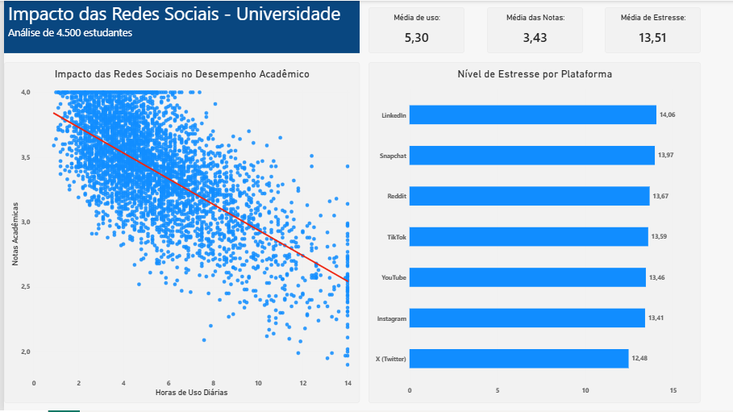

# 📊 Impacto das Redes Sociais no Desempenho e Saúde Mental dos Estudantes

## 🎯 O Projeto
Este projeto de análise de dados explora como o uso das redes sociais afeta o desempenho académico (GPA), a qualidade do sono e os níveis de stress de estudantes universitários. O objetivo foi aplicar uma abordagem rigorosa para extrair insights comportamentais a partir de dados brutos.

## 🛠️ Ferramentas Utilizadas
- **Python (Pandas, Matplotlib, Seaborn):** Limpeza de dados, tratamento de valores nulos e Análise Exploratória de Dados (EDA).
- **Power BI:** Construção de um dashboard interativo para apresentação executiva aos decisores.
- **Metodologia:** CRISP-DM (Cross-Industry Standard Process for Data Mining).

## 💡 Principais Descobertas
1. **Desempenho Académico:** Identificámos uma forte correlação negativa (-0.70) entre o tempo gasto nas redes sociais e as notas (GPA).
2. **Stress por Plataforma:** O LinkedIn apresentou a maior média de stress reportada pelos alunos, seguido de perto pelo Snapchat.
3. **Qualidade do Sono:** O uso de ecrãs de madrugada resulta numa perda de aproximadamente 40 minutos de sono por noite e reduz significativamente a qualidade do descanso.
4. **Demografia:** A análise provou não existirem variações comportamentais significativas com base no género dos estudantes, indicando que o impacto é universal.
